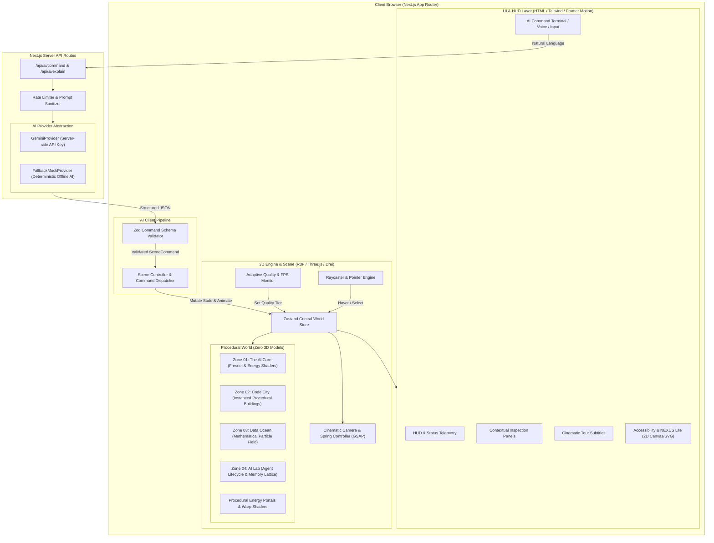

# NEXUS — Master Architecture & Implementation Plan (Phase 0)

> **Tagline**: *An interface between humans, intelligence, and digital space.*

NEXUS is an immersive, futuristic, AI-native 3D web experience where the digital environment itself is the interface. The entire world is procedurally generated from mathematical code, primitives, instancing, and GLSL shaders—without using any external 3D models (.gltf, .obj, .fbx, .blend).

---

## 1. System Architecture Overview



---

## 2. Folder Structure

```
c:/GitHub Projects/Working/World/
├── app/
│   ├── layout.tsx                # Metadata, fonts (Inter/Outfit), root layout
│   ├── page.tsx                  # Main entry point (Boot, canvas loader, shell)
│   ├── lite/
│   │   └── page.tsx              # NEXUS Lite (Accessible 2D SVG/Canvas fallback)
│   └── api/
│       ├── ai/
│       │   ├── command/route.ts  # Natural language -> Structured command
│       │   ├── explain/route.ts  # Contextual object/zone narration
│       │   └── tour/route.ts     # Generative cinematic tour scripts
│       └── health/route.ts       # System diagnostics & provider status
├── components/
│   ├── canvas/
│   │   ├── NexusCanvas.tsx       # Primary R3F Canvas with Suspense & Canvas fallback
│   │   ├── SceneManager.tsx      # World root, zone switcher, post-processing
│   │   ├── CameraRig.tsx         # Camera choreography, smooth lerp & GSAP triggers
│   │   └── Lighting.tsx          # Dynamic cinematic lighting (optimized)
│   ├── ui/
│   │   ├── Terminal.tsx          # Futuristic command terminal overlay
│   │   ├── TelemetryHUD.tsx      # Zone telemetry, FPS, quality badge, coords
│   │   ├── InspectModal.tsx      # Procedural node inspection card (HTML/Framer)
│   │   ├── TourOverlay.tsx       # Cinematic subtitles & tour controls
│   │   ├── AudioToggle.tsx       # Procedural audio synthesiser controller
│   │   ├── QualitySelector.tsx   # Manual/Auto quality override modal
│   │   └── BootScreen.tsx        # Procedural initialization screen with actual metrics
│   └── a11y/
│       ├── ReducedMotionNotice.tsx
│       └── ScreenReaderLive.tsx  # ARIA live announcements for 3D state changes
├── engine/
│   ├── store/
│   │   ├── useWorldStore.ts      # Central Zustand store (Zones, camera, quality, tour)
│   │   └── useAudioStore.ts      # Web Audio API procedural synthesis store
│   ├── camera/
│   │   ├── cameraWaypoints.ts    # Coordinates & look-at vectors for every zone/POI
│   │   └── transitions.ts        # GSAP camera transition curves
│   ├── interaction/
│   │   ├── RaycastManager.tsx    # Pointer move / click / touch event dispatcher
│   │   └── TouchControls.tsx     # Pinch-to-zoom, drag-to-orbit for mobile
│   ├── performance/
│   │   ├── QualityManager.ts     # Ultra/High/Med/Low presets & tier adjuster
│   │   └── FPSMonitor.ts         # Rolling frame delta & hysteresis logic
│   └── audio/
│       └── ProceduralAudio.ts    # Web Audio API synthesizers (ambient hum, beeps, warp)
├── procedural/
│   ├── core/
│   │   ├── CoreGeometry.ts       # AI Core composite (rings, inner sphere, nodes)
│   │   └── CoreParticles.ts      # Orbiting energy particulate buffer
│   ├── city/
│   │   ├── BuildingGenerator.ts  # Algorithmic skyscraper builder with instanced windows
│   │   ├── CityLayout.ts         # Deterministic grid with seeded randomness (PRNG)
│   │   └── CircuitLines.ts       # Glowing street pathways & data buses
│   ├── ocean/
│   │   ├── ParticleField.ts      # Mathematical point cloud (Wave, Sphere, Chaos, Grid)
│   │   └── MathTransforms.ts     # Morphing formulas: f(u,v,t) -> position buffer
│   ├── lab/
│   │   ├── AgentObject.ts        # AI Agent (Perceive->Reason->Plan->Act->Observe)
│   │   ├── MemoryLattice.ts      # Glowing 3D node lattice with dynamic links
│   │   └── ToolsCluster.ts       # Modular procedural floating tool blocks
│   ├── portals/
│   │   └── WarpPortal.ts         # Gateway rings & event-horizon procedural discs
│   ├── materials/
│   │   ├── MaterialFactory.ts    # Reusable shared materials (Metal, Glass, Grid, Glow)
│   │   └── TextureGenerators.ts  # Canvas 2D procedural noise, circuit, & grid textures
│   └── prng/
│       └── SeededRandom.ts       # Deterministic PRNG (Mulberry32 / LCG)
├── shaders/
│   ├── core/
│   │   ├── core.vert.glsl        # Vertex displacement with animated 3D simplex noise
│   │   └── core.frag.glsl        # Fresnel rim glow, chromatic aberration, energy pulse
│   ├── portal/
│   │   ├── portal.vert.glsl      # Twisting coordinate warp
│   │   └── portal.frag.glsl      # Swirling accretion disk & distance fade
│   ├── ocean/
│   │   ├── ocean.vert.glsl       # Point sizing, wave oscillation & state morphing
│   │   └── ocean.frag.glsl       # Particle attenuation, color ramp, glow
│   └── hologram/
│       └── hologram.frag.glsl    # Scanlines, glitch flickers, alpha falloff
├── ai/
│   ├── provider/
│   │   ├── AIProvider.interface.ts # Universal contract (interpret, explain, tour)
│   │   ├── GeminiProvider.ts       # Google Gemini API integration
│   │   └── FallbackProvider.ts     # Offline deterministic mock provider
│   ├── schema/
│   │   └── commandSchema.ts      # Zod validation schema for SceneCommand
│   ├── interpreter/
│   │   └── CommandParser.ts      # JSON parser, prompt sanitizer, fallback recovery
│   └── executor/
│       └── SceneController.ts    # Bridge from validated SceneCommand to 3D World actions
├── types/
│   ├── world.ts                  # Zone, POI, QualityTier, CameraMode types
│   ├── commands.ts               # SceneCommand, AIResponse types
│   └── shaders.ts                # Uniform types & GLSL declarations
├── styles/
│   └── globals.css               # Tailwind setup, high-tech scrollbars, root tokens
└── docs/                         # Architecture, guides, procedural docs
```

---

## 3. World Spatial Layout & Coordinates

The 4 zones are arranged in a coherent spatial coordinate map connected by procedural portals:

```
                          [ ZONE 01: THE CORE ]
                               (0, 5, 0)
                                   │
                   ┌───────────────┴───────────────┐
                   ▼                               ▼
       [ ZONE 02: CODE CITY ]             [ ZONE 03: DATA OCEAN ]
           (-60, 0, 40)                         (60, -10, 40)
                   │                               │
                   └───────────────┬───────────────┘
                                   ▼
                         [ ZONE 04: AI LAB ]
                             (0, -5, 120)
```

| Zone | Coordinates $(X, Y, Z)$ | Key Procedural Features | Atmosphere / Lighting |
| :--- | :--- | :--- | :--- |
| **01. The Core** | `(0, 5, 0)` | Floating AI Core, 3 nested rotating orbital rings, inner plasma sphere, 1,500 orbiting data nodes | Dark void, deep cyan/electric blue point lights, Fresnel rim |
| **02. Code City** | `(-60, 0, 40)` | Seeded grid of 48 procedural buildings (Frontend, Backend, Database, AI, Cloud, Security), procedural window grids, holographic banners, street circuit conduits | Midnight graphite, neon emerald & amber conduits, atmospheric fog |
| **03. Data Ocean** | `(60, -10, 40)` | 20,000–50,000 particle field morphing dynamically between 4 states: `Chaos` $\to$ `Wave` $\to$ `Lattice` $\to$ `Knowledge Sphere` | Deep indigo/violet glow, reactive pointer wave ripples |
| **04. AI Lab** | `(0, -5, 120)` | Floating Agent Core (5-stage state machine), Memory Lattice (connected graph), 6 floating tool modules (Search, Math, DB, Code, File, API) | Platinum white & cobalt, clean architectural lab lighting |
| **Portals** | Intermediate nodes | Concentric segmented rings with procedural particle vortex | Warm gold / violet event horizon glow |

---

## 4. Procedural 3D Generation Strategy (Zero Models)

1. **Composite Primitives**:
   - Every object is built by nesting mathematical geometries (`BoxGeometry`, `SphereGeometry`, `CylinderGeometry`, `TorusGeometry`, `IcosahedronGeometry`, `RingGeometry`, `TubeGeometry`).
   - Example: **AI Core** = Inner `IcosahedronGeometry(detail: 3)` + Middle `SphereGeometry` with custom GLSL displacement + 3 `TorusGeometry` rings with variable rotation speeds + `Points` cloud.
2. **Seeded PRNG (`Mulberry32`)**:
   - `SeededRandom(seed)` generates identical city layouts, building heights, window distributions, and laboratory lattice nodes on every run.
3. **Instanced Rendering (`InstancedMesh`)**:
   - Code City buildings and window clusters are rendered using `InstancedMesh` with dynamic transform matrices (`setMatrixAt`) and instance colors (`setColorAt`), keeping draw calls under 25 for the entire city.
4. **Procedural 2D Texture Generator**:
   - Off-screen HTML5 `<canvas>` creates high-resolution normal/bump maps for:
     - Window grids with random illuminated offices.
     - Printed circuit board (PCB) traces for ground planes.
     - Hologram barcode/digital scanline masks.
   - Converted into `THREE.CanvasTexture` with mipmapping and anisotropic filtering.

---

## 5. AI Command Architecture & Schema

### Universal AI Provider Interface
```typescript
export interface IAIProvider {
  interpretCommand(prompt: string, currentContext: SceneContext): Promise<SceneCommandResult>;
  explainObject(objectId: string, zoneId: string): Promise<string>;
  generateTourStep(stepIndex: number, totalSteps: number): Promise<TourStepData>;
}
```

### Strict Zod Command Schema
```typescript
import { z } from "zod";

export const SceneCommandSchema = z.discriminatedUnion("action", [
  z.object({
    action: z.literal("navigate"),
    target: z.enum(["core", "code_city", "data_ocean", "ai_lab"]),
    speed: z.enum(["normal", "cinematic", "fast"]).optional().default("cinematic"),
  }),
  z.object({
    action: z.literal("inspect"),
    target: z.enum(["ai_core", "agent", "memory", "tools", "database", "frontend", "backend", "security", "cloud"]),
  }),
  z.object({
    action: z.literal("explain"),
    topic: z.string().max(100),
  }),
  z.object({
    action: z.literal("change_environment"),
    property: z.enum(["lighting", "speed", "particle_density", "color_scheme"]),
    value: z.string().max(50),
  }),
  z.object({
    action: z.literal("transform_ocean"),
    state: z.enum(["chaos", "wave", "lattice", "sphere"]),
  }),
  z.object({
    action: z.literal("start_tour"),
  }),
  z.object({
    action: z.literal("reset_world"),
  }),
  z.object({
    action: z.literal("set_quality"),
    tier: z.enum(["ultra", "high", "medium", "low"]),
  }),
]);

export type SceneCommand = z.infer<typeof SceneCommandSchema>;
```

### Security & Prompt Injection Defense
- Natural language input from the user is sent to `/api/ai/command`.
- Server system prompt forces structured JSON output with temperature 0.1.
- AI output is validated against `SceneCommandSchema`.
- If invalid or hallucinated, the system falls back to a graceful explanatory response without modifying the 3D state.
- **Strictly No `eval()`, No `Function()`, No `innerHTML`**.

---

## 6. Centralized Scene State Architecture (Zustand)

```typescript
interface WorldState {
  currentZone: "core" | "code_city" | "data_ocean" | "ai_lab";
  cameraMode: "free" | "orbit" | "focus" | "cinematic" | "tour";
  selectedObject: string | null;
  qualityLevel: "ultra" | "high" | "medium" | "low";
  isReducedMotion: boolean;
  isAudioMuted: boolean;
  tourState: {
    isActive: boolean;
    currentStep: number;
    totalSteps: number;
  };
  oceanState: "chaos" | "wave" | "lattice" | "sphere";
  fps: number;
  // Actions
  setZone: (zone: WorldState["currentZone"]) => void;
  inspectObject: (objectId: string | null) => void;
  setQualityLevel: (tier: WorldState["qualityLevel"]) => void;
  startTour: () => void;
  stopTour: () => void;
  setOceanState: (state: WorldState["oceanState"]) => void;
  updateFPS: (fps: number) => void;
}
```

---

## 7. Custom GLSL Shader Strategy

1. **AI Core Hero Shader (`core.frag.glsl` & `core.vert.glsl`)**:
   - Vertex: 3D simplex noise displacing vertex normals along time $uTime$.
   - Fragment: Fresnel rim lighting $(1.0 - \max(0, \vec{n} \cdot \vec{v}))^p$, inner energy pulse, smooth step chromatic dispersion.
2. **Data Ocean Particle Shader (`ocean.vert.glsl`)**:
   - Smoothly interpolates vertex coordinates between attribute buffers `aPosChaos`, `aPosWave`, `aPosLattice`, `aPosSphere` using uniform $uMorphProgress \in [0, 1]$.
   - Dynamic size attenuation based on camera distance and mouse proximity.
3. **Portal Accretion Disk Shader (`portal.frag.glsl`)**:
   - Polar coordinates $(r, \theta)$ with logarithmic spiral UV rotation, edge glow, and alpha falloff.
4. **Hologram Glitch Shader (`hologram.frag.glsl`)**:
   - Horizontal scanline frequency, periodic pseudo-random glitch offset, chromatic edge aberration.

---

## 8. Adaptive Performance & Memory Strategy

| Quality Tier | Particle Count | Instanced Mesh Detail | Shadows | Post-Processing | Target Devices |
| :--- | :--- | :--- | :--- | :--- | :--- |
| **ULTRA** | 50,000 | Full windows + antennas | Soft Shadows (PCF) | Bloom + Chromatic Aberration | High-end Desktops (RTX / M-series Pro) |
| **HIGH** | 25,000 | Standard building facades | Basic directional | Light Bloom | Modern Laptops / Desktops |
| **MEDIUM** | 10,000 | Simplified geometry | Off | Minimal | Modern Phones & Tablets |
| **LOW** | 3,000 | Minimal primitives | Off | Off (Raw Canvas) | Low-spec phones / Integrated GPUs |

- **FPS Hysteresis**: Rolling 120-frame average. If FPS $< 28$ for 4 consecutive seconds, downgrade tier. If FPS $> 55$ for 15 seconds, upgrade tier. Never oscillate.
- **Resource Disposal**: On zone change or teardown, systematically invoke `geometry.dispose()`, `material.dispose()`, and `texture.dispose()`.

---

## 9. Mobile & Touch Strategy

- Touch events mapped to:
  - **1-Finger Drag**: Orbit / Look around.
  - **Pinch**: Smooth dolly zoom in/out.
  - **Tap**: Raycast inspect object.
  - **Double Tap**: Quick focus/center on tapped point of interest.
- Virtual joystick or on-screen directional pan controls.
- Viewport height lock (`100dvh`) to prevent mobile browser address bar jitter.
- Target particle counts capped to Medium/Low tiers automatically on mobile user agents.

---

## 10. Accessibility (a11y) & Fallback Mode

- **Reduced Motion**:
  - Detects `prefers-reduced-motion: reduce`.
  - Disables GSAP cinematic camera swoops; uses instant cross-fades and smooth static viewports.
  - Halves particle animation velocity.
- **Screen Reader Announcements (`aria-live`)**:
  - Zone transitions and object inspections announce descriptions to screen readers.
- **Full Keyboard HUD**:
  - `Tab` navigates between interactive objects.
  - `1`, `2`, `3`, `4` keys jump directly to Core, City, Ocean, Lab.
  - `Space` triggers inspection; `Esc` clears selection.
- **NEXUS Lite (2D Fallback)**:
  - Accessible via `/lite` or automatic WebGL failure detection.
  - Built with clean SVG diagrams, canvas waveforms, and HTML telemetry displaying all architectural data without requiring WebGL support.

---

## 11. Security Strategy

- Gemini API key strictly server-side (`GEMINI_API_KEY` in `.env.local`).
- Server routes sanitize user inputs (100-character cap, regex alphanumeric filtering).
- In-memory rate limiting: 15 requests/minute per client IP.
- Zero client-side eval, `new Function()`, or dynamic code execution.

---

## 12. Phased Roadmap

- **Phase 0**: Architecture & Blueprint *(Current)*
- **Phase 1**: Project Foundation (Next.js 14/15, TypeScript, Tailwind, Lucide, fonts, layout, UI shell, boot screen)
- **Phase 2**: WebGL Core & R3F Setup (Canvas, lighting, camera controller, procedural AI Core with rings & particles)
- **Phase 3**: Procedural Engine (Building generator, instanced meshes, particle engine, procedural canvas textures)
- **Phase 4**: Complete 4-Zone World (Core, Code City, Data Ocean, AI Lab, interconnected spatial layout)
- **Phase 5**: Interaction & Pointer Engine (Raycaster, cursor halo, hover states, click inspection modal)
- **Phase 6**: Cinematic Camera & GSAP Choreography (Zone transitions, portal leaps, waypoint navigation)
- **Phase 7**: Custom GLSL Hero Shaders (AI Core Fresnel, morphing Data Ocean particles, warp portal)
- **Phase 8**: AI Command Pipeline & Schema (Next.js server route, GeminiProvider + FallbackProvider, Zod validation, scene executor)
- **Phase 9**: Interactive AI Tour Guide (Automated cinematic flythrough with live procedural object narration)
- **Phase 10**: Experimental Sandbox Controls (Real-time particle density, ocean state morphing, lighting adjustments)
- **Phase 11**: Mobile Optimization (Touch gestures, 100dvh layout, low-power adaptive mode)
- **Phase 12**: Performance Tuning (Adaptive quality engine, FPS monitor, draw call batching)
- **Phase 13**: Accessibility & NEXUS Lite (2D SVG fallback, reduced motion, keyboard controls)
- **Phase 14**: Security Audit (Rate limiting, input sanitization, zero unsafe execution) — *Completed*
- **Phase 15**: Audio & Polish (Web Audio API procedural sound synthesizer, micro-interactions, easter eggs) — *Completed*
- **Phase 16**: Final QA, Documentation & Verification (Desktop, mobile, offline test, docs/ suite) — *Completed*

---

## Verification Plan

### Automated Checks
- `npm run build` / Next.js production build verification.
- TypeScript compiler validation (`tsc --noEmit`).
- Schema validation unit tests for all allowed `SceneCommand` variants.

### Manual Verification
- Verify 60 FPS in desktop Chrome/Firefox with WebGL inspector.
- Inspect draw calls via `gl.info` (< 50 draw calls).
- Verify zero external 3D model requests in the network tab.
- Test touch gestures on mobile simulator.
- Verify screen reader announcements and Reduced Motion mode.
- Test fallback AI provider when `GEMINI_API_KEY` is not present.
